# Algerian Second-Hand Furniture & Home Appliances Market Research Platform
## منصة دراسة الجدوى وأبحاث سلوك المستهلك الجزائري لسوق الأثاث والأجهزة المستعملة

An enterprise-grade, bilingual (Arabic RTL & English LTR) market research platform and behavioral analytics intelligence engine, built to investigate consumer habits, trust barriers, logistics feasibility, and commercial opportunities for an organized second-hand household goods marketplace in Algeria.

---

## 📌 Executive Summary & Problem Statement

The secondary market for furniture and home appliances in Algeria represents a massive economic opportunity, yet remains fragmented, informal, and plagued by severe friction:
- **Mechanical & Compressor Uncertainty:** Inability to verify the real technical condition of refrigerators, washing machines, and air conditioners prior to purchase.
- **Logistics & Bulky Freight Friction:** Traditional parcel couriers (Yalidine, ZR Express) only transport small parcels. Moving sofas and large appliances currently relies on informal street haulers without padded protection or stair-lifting assistance.
- **Distrust & Fraud Risks:** High incidence of scam deposits on social media classifieds, misleading photos, and complete absence of operational warranties or return policies.

This platform bridges the data gap by gathering quantitative and qualitative insights across all 58 Algerian wilayas, analyzing consumer psychology, and deriving algorithmic customer segments to guide the launch of a verified vertical marketplace.

---

## 📸 Platform Visual Showcase (Genuine Application Screenshots)

### 1. Interactive Survey Journey

| Arabic Homepage (RTL) | English Homepage (LTR) |
| :---: | :---: |
| 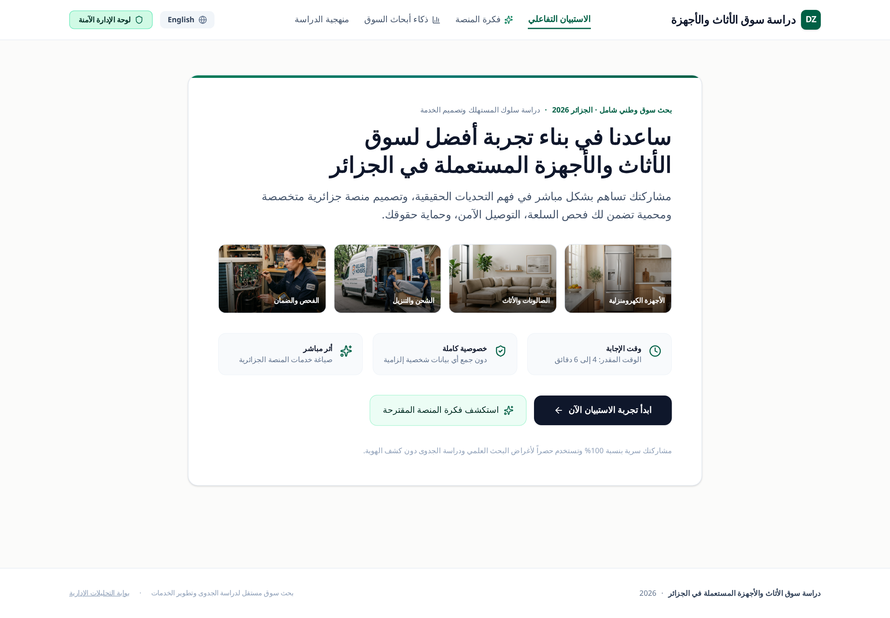 | 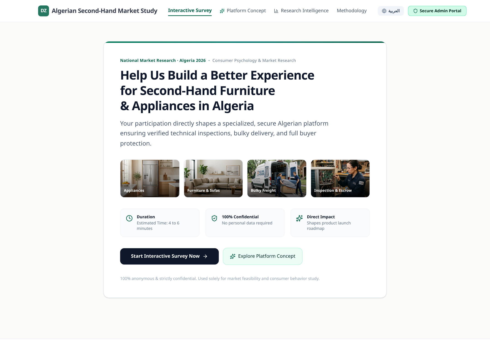 |
| *Bilingual welcome portal with duration counter and confidentiality guarantee* | *English localized entry point for international researchers and partners* |

| Category Selection with Verified Visual Cards | Interactive Questions & Real-Time Feedback |
| :---: | :---: |
| 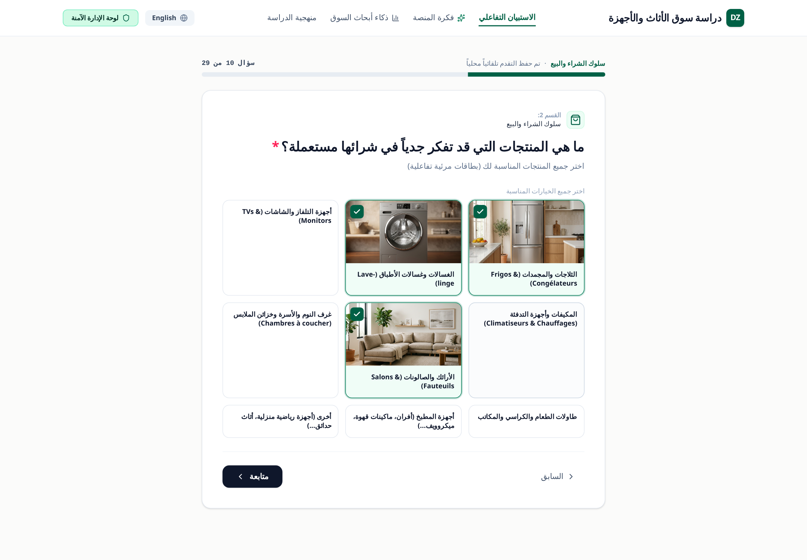 | 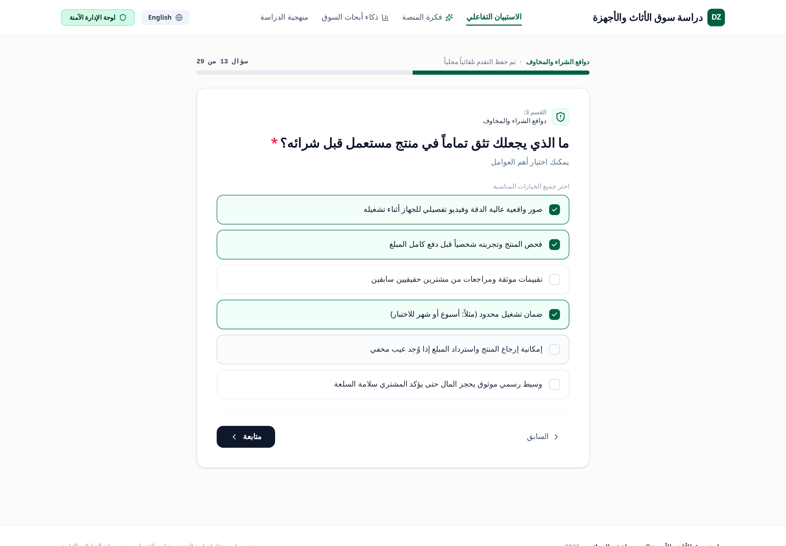 |
| *Tactile category selector featuring real furniture & household appliance photography* | *Contextual multi-choice questions with progress indicator and auto-save* |

| Heavy Logistics & Payment Preferences | Celebratory Completion & Waitlist Onboarding |
| :---: | :---: |
| 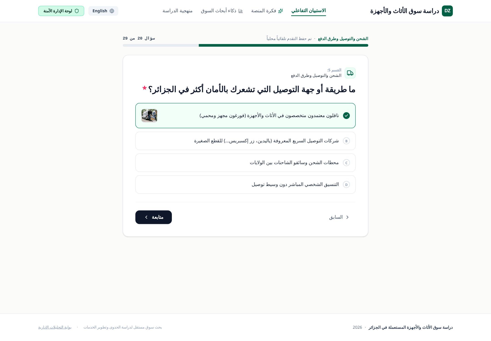 | 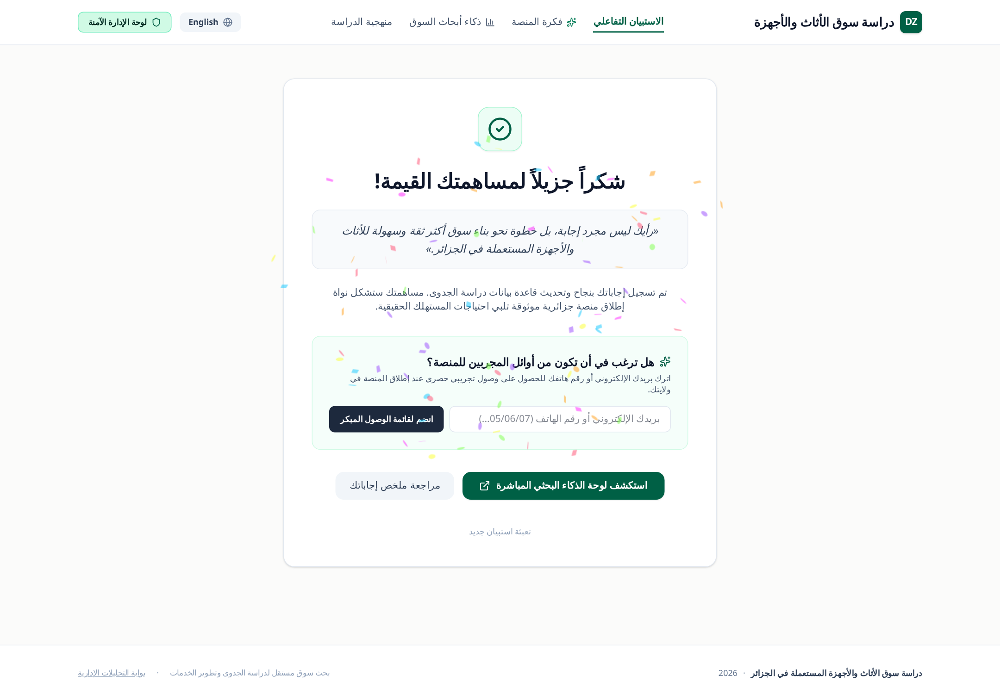 |
| *Freight fee acceptance, mover preferences, and payment method exploration* | *Submission confirmation with priority beta waitlist for early platform access* |

| Mobile-First Responsive Experience |
| :---: |
| 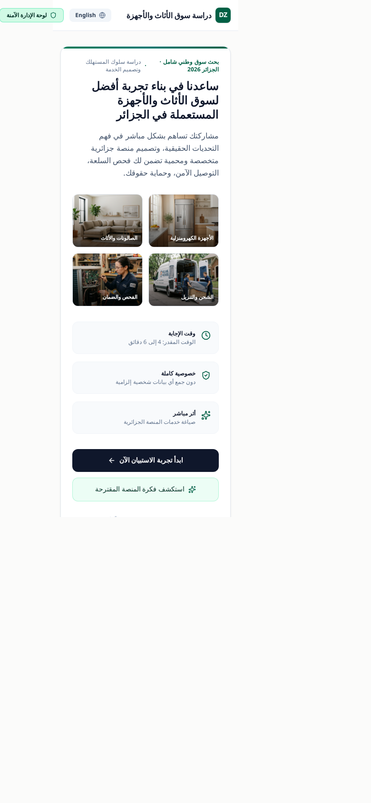 |
| *Native-feeling 390×844 mobile viewport optimized for Algerian smartphone users* |

---

### 2. Market Research Intelligence Suite (Admin Portal)

| Executive Overview & Strategic KPIs | Consumer Behavior & Decision Funnel |
| :---: | :---: |
| 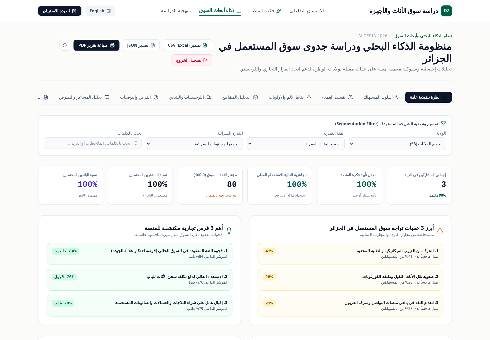 | 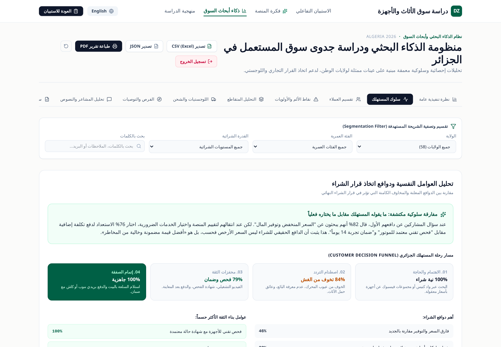 |
| *Core metric cards (approval rate, trust index, willingness to use) with cohort filters* | *Stated vs. revealed preferences, acquisition channels, and purchasing motivations* |

| Behavioral Customer Segmentation | Friction Points & Commercial Priority |
| :---: | :---: |
| 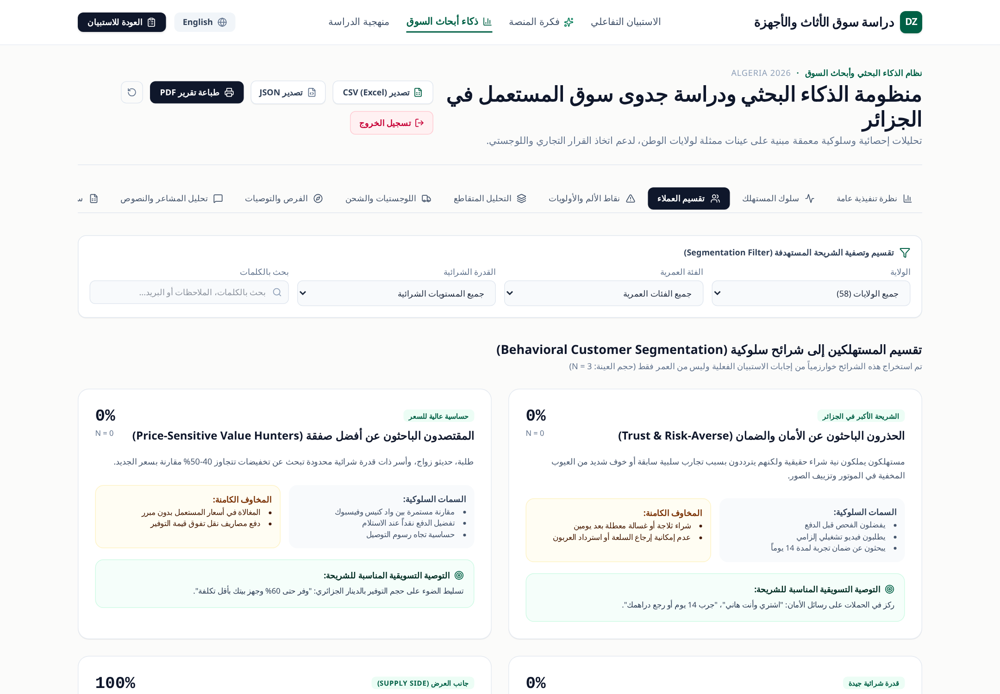 | 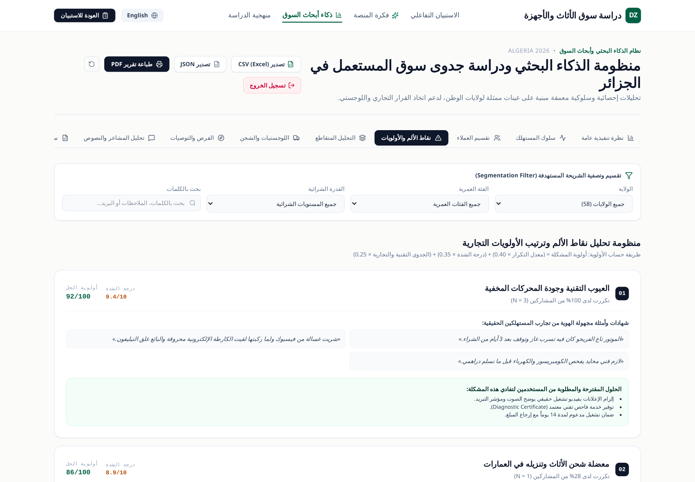 |
| *Algorithmic clustering into 5 consumer personas with sample size ($N$) metrics* | *Ranked friction points calculated via frequency, severity, and commercial impact* |

| Multi-Variable Cross-Tabulation & Heatmaps | Logistics & Bulky Freight Intelligence |
| :---: | :---: |
| 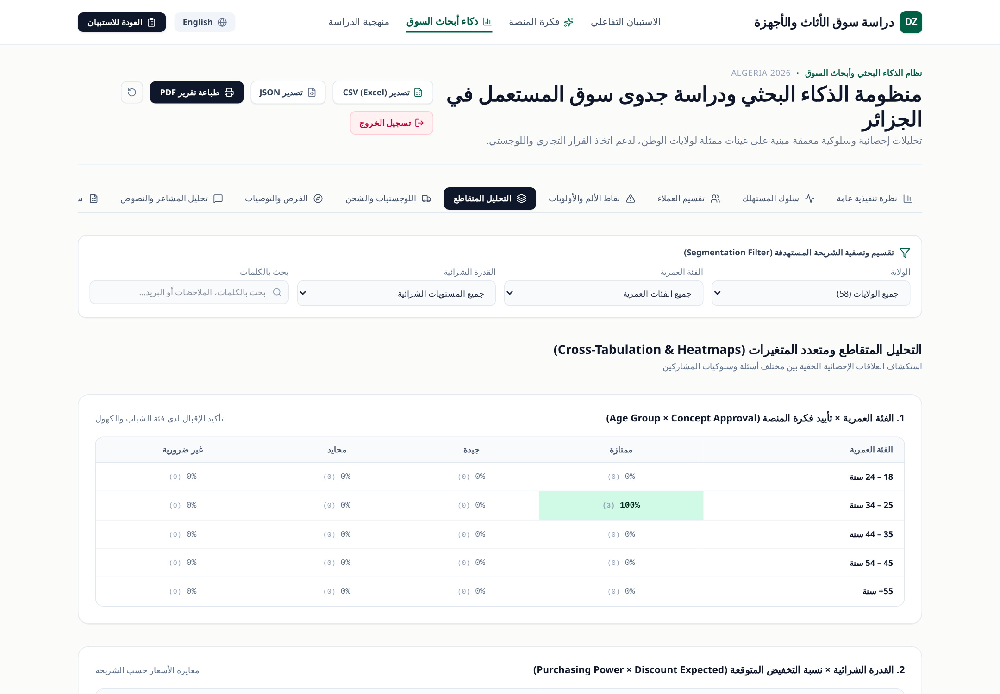 | 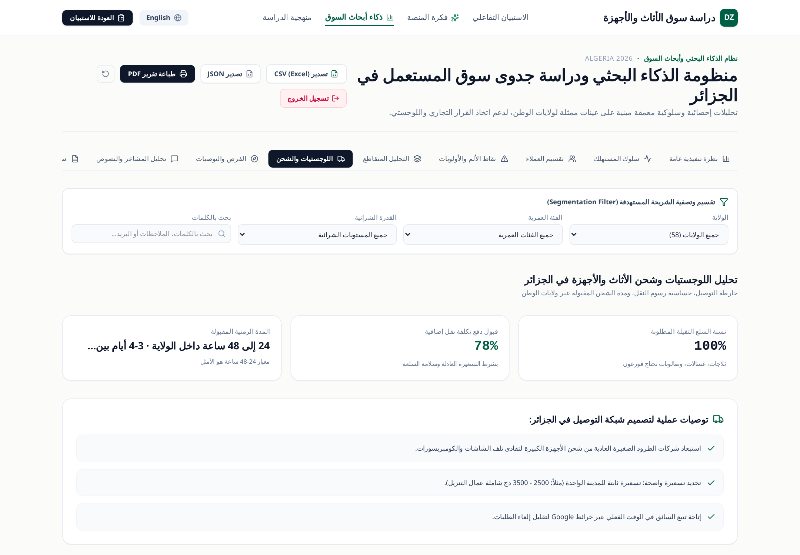 |
| *Interactive matrices correlating age, purchasing power, and wilaya trust barriers* | *Carrier preference breakdown, delivery pricing tolerance, and mover logistics* |

| Strategic Opportunities & Launch Backlog | Qualitative Sentiment & NLP Text Mining |
| :---: | :---: |
| 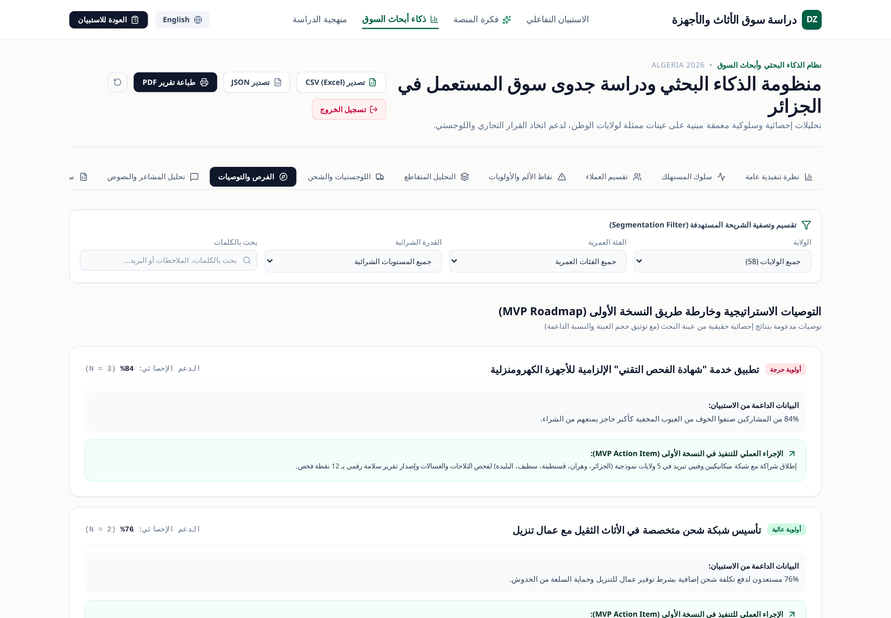 | 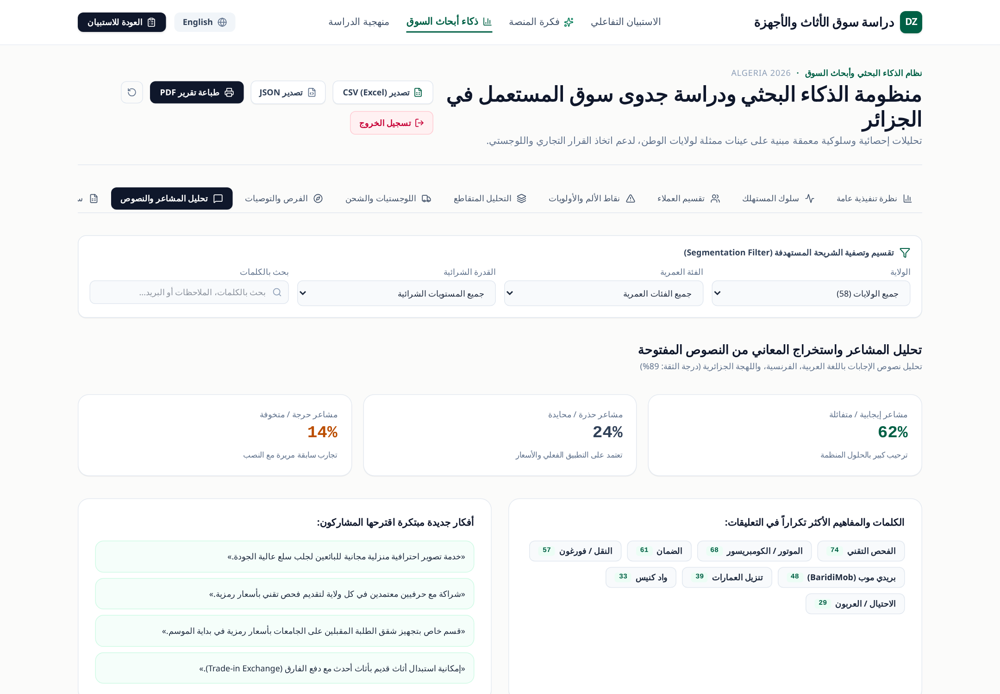 |
| *Evidence-backed feature backlog with sample size validation and MVP recommendations* | *Multilingual VoC text analysis covering Arabic, French, and Algerian Darja* |

---

## 🚀 Key Features & Capabilities

### A. Intelligent Survey Engine
- **8 Comprehensive Research Sections:** Demographics, purchasing habits, motivations & hesitation triggers, platform concept evaluation, logistics & payment methods, past issues & fraud, wishlist features, and priority waitlist.
- **Dynamic Conditional Branching:** Smart question logic showing follow-up technical questions only to relevant respondents (e.g., past issue drill-downs, seller-specific onboarding incentives).
- **Client-Side Auto-Save:** Instant progress serialization to `localStorage`, allowing participants to resume incomplete drafts at any time.
- **Micro-Interactions & Visual Richness:** High-resolution product preview cards, smooth step transitions, and real-time validation.

### B. Enterprise Research Intelligence Suite
- **Algorithmic Customer Segmentation:** Automatic clustering into distinct behavioral personas (*Trust & Risk-Averse*, *Value & Price Hunters*, *Quality & Brand Seekers*, *Convenience-Oriented*, *Potential Sellers*) with exact cohort sample sizing ($N$) and actionable marketing directives.
- **Pain Points Ranking Formula:** Prioritizes commercial opportunities using a weighted formula:
  $$\text{Priority Score} = (\text{Frequency \%} \times 0.40) + (\text{Severity Score} \times 0.35) + (\text{Commercial Impact} \times 0.25)$$
- **Multi-Variable Cross-Tabulation & Heatmaps:** Interactively cross-references Age $\times$ Approval, Purchasing Power $\times$ Expected Discount, Past Issues $\times$ Trust Catalysts, and Wilaya $\times$ Freight Preferences.
- **Qualitative Voice of Customer (VoC):** Sentiment analysis and thematic extraction supporting Arabic, French, and Algerian dialect (*Darja*) with confidence ratings and anonymized quote cards.
- **Logistics & Bulky Freight Blueprint:** Concrete operational directives for establishing an inter-wilaya furniture carrier network with two-man lifting teams.
- **Data Export & Reporting:** Export to UTF-8 BOM CSV (compatible with Microsoft Excel Arabic text), JSON data export, and browser-ready PDF report generation.

### C. Security & Admin Authentication
- **Zero Plaintext Credentials:** Password validation executed exclusively on the backend using timing-safe `bcryptjs` hashing.
- **Secure Session Management:** Signed cryptographic session tokens stored in `HttpOnly`, `SameSite=Strict`, and `Secure` cookies.
- **Brute-Force Rate Limiting:** Enforces a maximum of 5 failed login attempts per 15-minute window per IP with temporary lockouts.
- **Inactivity Session Expiry:** Automatic session invalidation after 30 minutes of inactivity.
- **Protected API Endpoints:** All analytics and respondent records (`/api/responses`, `/api/seed`) require valid admin session tokens.

---

## 🛠 Tech Stack & Architecture

- **Frontend:** React 19, TypeScript, Tailwind CSS, Motion, Lucide Icons, Canvas-Confetti.
- **Backend & Middleware:** Node.js, Express, tsx, Cookie-Parser, Bcryptjs.
- **Automation & Screenshot Engine:** Headless Playwright Chromium.
- **Data Persistence:** Local JSON database file storage (`/data/responses.json`) synchronized with browser LocalStorage for zero-latency client resiliency.
- **Typography:** `Plus Jakarta Sans` for Latin headings/numerals and `IBM Plex Sans Arabic` for Arabic typography.

---

## 📦 Project Structure

```text
├── assets/                       # High-resolution photographic assets
│   ├── appliances/               # Refrigerator, washing machine imagery
│   ├── delivery/                 # Freight van and technical inspection
│   └── furniture/                # Living room sofa photography
├── data/
│   └── responses.json            # Persistent JSON survey database
├── screenshots/                  # Authentic application screenshots
│   ├── analytics/                # 8 Research Intelligence Suite dashboard screens
│   ├── mobile/                   # 390×844 responsive mobile view
│   └── survey/                   # 6 Survey journey & interaction views
├── scripts/
│   ├── capture-real-screenshots.js # Automated Playwright Chromium browser capture
│   └── generate-password-hash.js   # CLI utility to generate bcrypt admin hashes
├── src/
│   ├── components/
│   │   ├── AboutStudy.tsx        # Methodology and privacy standards
│   │   ├── AdminDashboard.tsx    # Research Intelligence Suite & Heatmaps
│   │   ├── AdminLoginModal.tsx   # Secure password login dialog
│   │   ├── ConceptModal.tsx      # Platform vision & four pillars showcase
│   │   ├── Navbar.tsx            # Sticky top bar with language & view switcher
│   │   └── SurveyWizard.tsx      # Interactive questionnaire journey
│   ├── data/
│   │   ├── mockData.ts           # Realistic nationwide baseline seed dataset
│   │   ├── questions.ts          # Complete bilingual questionnaire definitions
│   │   └── wilayas.ts            # Official list of all 58 Algerian wilayas
│   ├── services/
│   │   └── storage.ts            # Analytics calculations, auth client, & CSV export
│   ├── translations/
│   │   └── index.ts              # Bilingual localization dictionary
│   ├── types/
│   │   └── survey.ts             # TypeScript data contracts & intelligence types
│   ├── App.tsx                   # Root state & view orchestration
│   ├── index.css                 # Tailwind CSS v4 styling & print media styles
│   └── main.tsx                  # Application mount point
├── .env.example                  # Environment template (no secrets)
├── package.json                  # Dependencies & scripts
├── server.ts                     # Full-stack Express server with Vite middleware
├── tsconfig.json                 # TypeScript compiler options
└── vite.config.ts                # Vite build configuration
```

---

## 💻 Installation & Local Development

### 1. Prerequisites
- **Node.js:** v18.0.0 or higher
- **npm:** v9.0.0 or higher

### 2. Clone and Install Dependencies
```bash
git clone https://github.com/your-username/dz-used-market-research.git
cd dz-used-market-research
npm install
```

### 3. Environment Variables Setup
Copy the environment template:
```bash
cp .env.example .env
```

To configure your own secure admin password, generate a bcrypt hash using the provided utility:
```bash
node scripts/generate-password-hash.js "YourStrongAdminPassword"
```
Then paste the resulting hash into your `.env` file:
```env
ADMIN_PASSWORD_HASH="$2a$10$..."
SESSION_SECRET="your-cryptographic-random-secret"
```

### 4. Running the Development Server
```bash
npm run dev
```
Open [http://localhost:3000](http://localhost:3000) in your browser.

---

## 🔐 Admin Access & Security Instructions

1. Click on the **"لوحة الإدارة الآمنة" / "Secure Admin Portal"** link in the header or footer.
2. Enter the administrator password configured in your environment.
3. Access is strictly authenticated against the backend. No passwords or tokens are stored in source code or Git history.
4. To test sample analytics immediately, an initial dataset of representative responses across 20+ Algerian wilayas is preloaded.

---

## 📊 Regenerating Screenshots
 
 To update or regenerate the screenshot gallery in `./screenshots`:
 ```bash
 node scripts/capture-real-screenshots.js
 ```

---

## 🚢 Production Build & Deployment

To compile for production:
```bash
npm run build
npm start
```
The application will serve static assets from `dist/` and handle API endpoints on port 3000 (or the port defined by `PORT`).

---

## 📄 License & Ethical Research Conduct

This project is developed for market research and feasibility analysis in Algeria. All survey responses are collected anonymously in compliance with research confidentiality standards. No personally identifiable information (PII) is displayed publicly or stored in unencrypted form.
